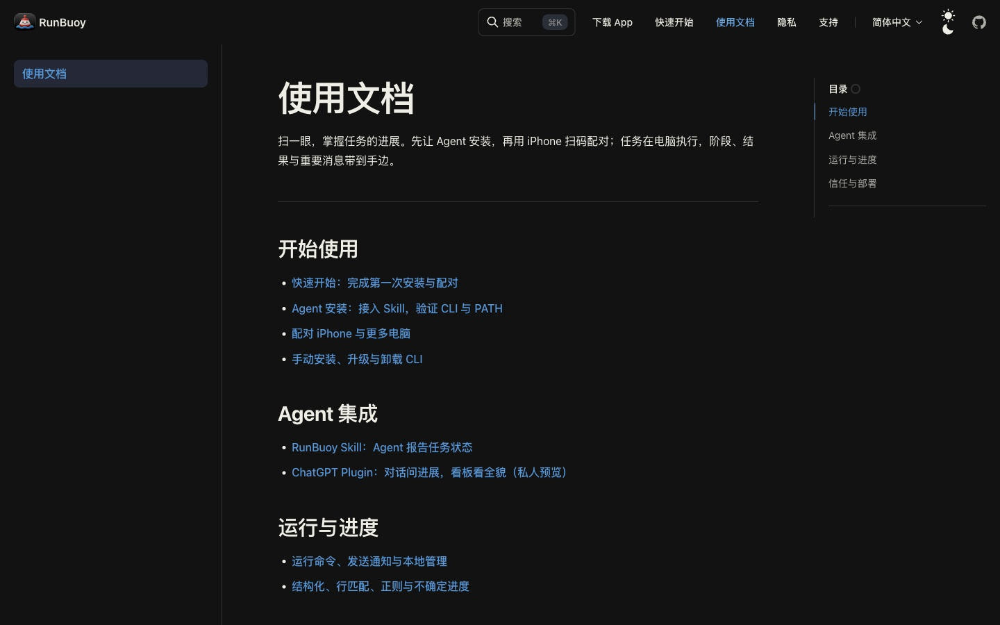
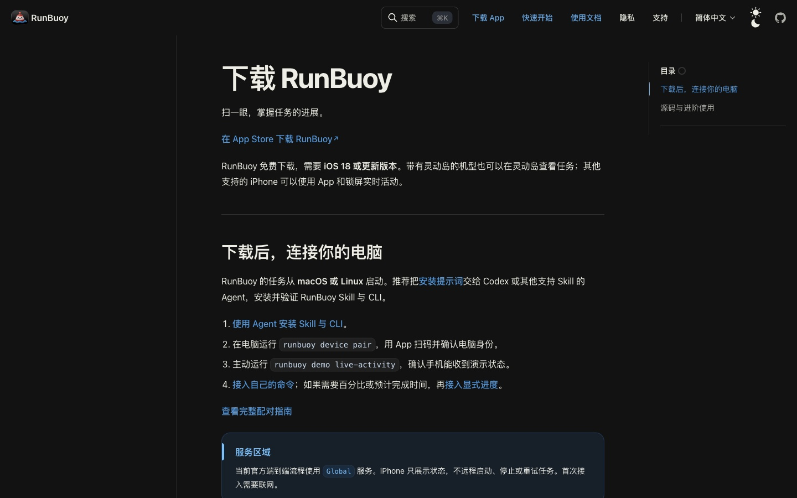
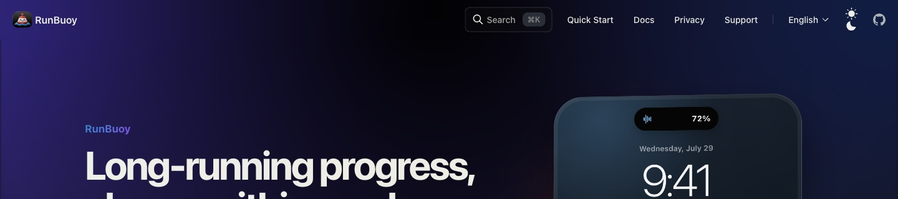

# 首页导航与文档路径审阅

日期：2026-10-06。范围：中文首页右上角四个入口，以及进入安装、下载、文档和语言页面后的路径。本轮仅审阅，未修改产品代码。

## 结论

首要问题是同名入口的去向与后续步骤不一致，其次是导航主次、语言弹层和窄屏可发现性。已检查的站内页面均可打开，未发现 404；这不代表文档体系已形成连续的上手流程。

## 按影响排序的发现

1. **P2：全站同名入口不同义。** 首页“快速开始”到 `/#agent-install`，文档页则到 `/guide/`；首页“下载 App”直接到 App Store，文档页同名入口到 `/download`。每条链接单独有效，但访客换页后无法稳定预测行为。建议全站导航快速开始统一到 `/guide/`，下载 App 统一到 `/download`；首页正文“连接我的电脑”继续使用页内安装入口，“App Store 下载”继续明确直达商店。
2. **P2：安装后的主线分叉。** 首页新增独立 Agent 配对提示词，但 `/guide/` 与 `/download` 仍主要提供手动 `runbuoy device pair`；指南页尾“下一页”又回到“安装 CLI”。建议快速开始成为安装、配对、首次运行的一套主流程，复用首页安装和配对组件/文本；完成后进入运行任务，升级/卸载/手动安装作为辅助资料。
3. **P2：文档目录缺少连续性。** `/docs/` 左栏仅“使用文档”一项，进入 `/guide/` 后变成六项；其中“安装 CLI”排在“Agent 集成与安装”之前。下载页左栏为空。建议文档首页与文章共享稳定目录，按开始使用、日常任务、Agent 集成、进阶与支持分组。文档首页承担检索和分流；快速开始承担顺序上手。
4. **P2：窄屏直接移除文档与语言入口。** 手机顶栏只保留“快速开始”，文档和 English 要到页尾才能找到。建议保留主要操作加菜单，菜单完整承接四个入口；不要让响应式简化变成入口迁移到页尾。
5. **P2：语言弹层缺少退出操作。** 点击打开和 Tab 进入 English 可用，焦点轮廓可见；实际按 Esc 和点击标题空白区域后仍保持展开。建议补 Esc、外部点击关闭，关闭后合理回焦；同时展示当前语言状态。
6. **P3：四项缺少视觉主次。** 当前都是 17px 深色文字、无内边距，点击区域高度约 27px；文字间距本身尚可。建议将下载作为末尾唯一按钮，快速开始/文档为普通导航，语言单独成组；目标高度 40–44px，文字 16–17px。这里是命中体验优化，不据此判定 WCAG 不合规。
7. **P3：首页与文档导航身份变化大。** 本次环境首页浅色，文档使用已保存的深色主题；文档增加搜索、隐私、支持及工具菜单。保留文档阅读主题合理，但应固定品牌、核心入口顺序和目标；搜索作为文档附加能力。英文首页成功打开，旧版视觉属于本轮原有范围边界，不当作语言跳转故障。

## 建议的入口契约

| 入口 | 固定职责 | 建议目标 |
| --- | --- | --- |
| 快速开始 | 完成第一次安装、配对与验证 | `/guide/`，Agent 优先，手动折叠 |
| 使用文档 | 查询功能、集成与故障排除 | `/docs/`，统一目录与检索 |
| 简体中文 | 切换页面语言 | 首页到 `/en/`；文档保留对应文章（后者本轮未测） |
| 下载 App | 将用户带到 iPhone 安装环节 | `/download`，桌面提供手机扫码入口和 App Store 链接 |

建议桌面视觉顺序：快速开始 → 使用文档 → 语言 → 下载 App。保留首页正文的双入口，不把所有导航项都做成实心按钮。

## 本次捕获步骤与健康度

1. 首页桌面导航：可读、可点击；主次不明显。截图 01。
2. 语言弹层：可打开、键盘可进入选项；Esc/外部点击关闭缺失。截图 02。
3. 首页快速开始：页内锚点到达安装/配对操作区，正常。截图 03。
4. 文档中心：路由正常，分类文字清楚，但左侧目录只有一项。截图 04。
5. 文档快速开始：正常打开 Agent 安装内容；导航结构和首页入口不同。截图 05。
6. 配对与下一步：内容可达，但仍以手动命令配对，下一页指向再次安装。截图 06；下一页目标另由当前 DOM 与 `_meta.json` 核对。
7. 文档中的下载 App：到站内下载页，目标正常；与首页直达商店行为不同。截图 07。
8. 首页语言切换：成功到 `/en/`，英文标题存在，正常。截图 08。
9. 窄屏首页：仅快速开始留在顶栏，文档与语言位于页脚。截图 09。

## 截图

### 01 桌面导航

### 02 语言菜单

### 03 首页快速开始落点

### 04 文档中心

### 05 文档快速开始

### 06 文档配对与下一步

### 07 下载页

### 08 语言切换落点

### 09 窄屏导航

## 证据边界

本轮只使用本次浏览器捕获、DOM 和当前源码作为审阅证据。保存了最初浏览器缩放下的测量值 `interaction-notes.json`；浏览器截图接口在该缩放下出现裁切偏差，异常截图已用明确页面区域的 CDP 捕获替换并逐张检查，不把工具裁切当作网页缺陷。响应式截图采用 390px 浏览器尺寸覆盖，未改变用户保存的缩放或主题偏好。

测试了站内跳转、返回首页、语言目标、键盘焦点及菜单关闭。只核对了 App Store 链接地址，没有触发下载/安装；未执行 Agent 安装或真实配对、屏幕阅读器/真机专项测试。文档文章的跨语言保持路径尚未验证。

相关源码：`website/theme/components/Nav/index.tsx`、`Nav/index.css`、`website/docs/zh/_nav.json`、`website/docs/zh/docs/index.mdx`、`website/docs/zh/guide/index.mdx`、`website/docs/zh/guide/_meta.json`、`website/docs/zh/download.md`。
